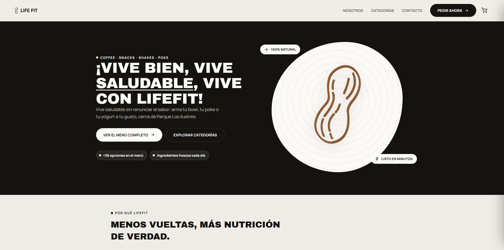

# LifeFit — Menú online de comida saludable

Menú digital para un negocio de comida saludable, con carrito de compras que termina en un mensaje de WhatsApp y un panel de administración protegido para gestionar todo el contenido sin tocar código. Desarrollado con **PHP, MySQL y JavaScript puro**.

**Sitio en vivo:** https://lifefitve.com



## Características

**Sitio público**
- Menú organizado por categorías, con productos individuales y productos con varios tamaños.
- **Constructores de comida:** el cliente arma su plato eligiendo ingredientes por grupos, con opción de tamaño **Normal o Mini** (cada uno con su precio y sus límites de selección).
- Descuentos aplicados automáticamente en el menú.
- **Carrito de compras** guardado en el navegador (`localStorage`): al confirmar, el pedido se envía como un mensaje de WhatsApp con un comentario opcional.
- Diseño responsive.

**Panel de administración** (`/admin`)
- Inicio de sesión protegido.
- **Categorías y productos:** crear, editar y eliminar, con fotos.
- **Constructores:** crear plantillas con sus grupos de ingredientes e ingredientes.
- **Descuentos:** por producto, categoría o constructor, probando primero el descuento más específico.
- **Configuración** del sitio y publicaciones destacadas.

## Tecnologías

PHP (PDO) · MySQL / MariaDB · HTML5 · CSS3 · JavaScript puro

## Seguridad

- Contraseñas guardadas con hash (`password_hash` / `password_verify`).
- Consultas con PDO y sentencias preparadas.
- Tokens CSRF en los formularios del panel.
- Bloqueo temporal del usuario tras varios intentos fallidos, guardado en la base de datos.
- Sesión regenerada al iniciar sesión y cookies con `HttpOnly` y `SameSite`.
- Cabeceras de seguridad y carpetas internas bloqueadas con `.htaccess`.
- Credenciales en variables de entorno (`.env`, fuera del repositorio).
- Instalador de un solo uso: exige una clave secreta y se desactiva cuando ya existe un administrador.

## Estructura del proyecto

```
admin/        Panel de administración (instalador, login, categorías, productos, constructores, descuentos)
assets/       CSS y JavaScript (main.js maneja el carrito)
database/     schema.sql y migracion_tamano_mini.sql
includes/     Configuración, conexión a la base de datos, autenticación, carrito y utilidades
menu/         Página del menú
index.php     Página principal
uploads/      Fotos subidas desde el panel (no se versiona)
```

## Cómo correrlo en local (XAMPP)

**Requisitos:** PHP 8+ con la extensión GD y MySQL/MariaDB.

1. Clona el repositorio dentro de la carpeta pública (en XAMPP: `C:\xampp\htdocs\lifefit`).
2. En phpMyAdmin crea una base de datos vacía e importa `database/schema.sql`; luego importa `database/migracion_tamano_mini.sql` (agrega las columnas del tamaño Mini).
3. Copia `.env.example` como `.env` y completa tus datos:

   | Variable | Para qué sirve |
   |---|---|
   | `DB_HOST`, `DB_NAME`, `DB_USER`, `DB_PASS` | Conexión a la base de datos (en XAMPP: `localhost`, `root`, contraseña vacía) |
   | `ADMIN_SETUP_KEY` | Clave de instalación, solo para crear el primer administrador (ver el paso 5) |
   | `APP_DEBUG` | `1` para ver errores en desarrollo, `0` en producción |

4. Las fotos subidas desde el panel se guardan en `uploads/`. Si la carpeta no se crea sola, créala y verifica que el servidor pueda escribir en ella.
5. **Crea tu usuario administrador.** Pon una clave larga en `ADMIN_SETUP_KEY` dentro de tu `.env` y abre una sola vez:

   ```
   http://localhost/lifefit/admin/instalar.php?key=TU_CLAVE_DE_INSTALACION
   ```

   Elige tu usuario y una contraseña de al menos 8 caracteres. El instalador **se desactiva solo** en cuanto existe un administrador (también puedes borrar `admin/instalar.php`).
6. Abre `http://localhost/lifefit/` para el sitio y `http://localhost/lifefit/admin/login.php` para el panel.

## Tamaño Mini

Un constructor puede tener versión Mini: se activa asignando `precio_mini` en la tabla `constructores` y, por grupo, `seleccion_min_mini` / `seleccion_max_mini` en `grupos_ingredientes` (el ejemplo está comentado al final de la migración). Por ahora estos campos se editan directamente en la base de datos, no desde el panel.

## Notas

Hecho para un negocio real. Código compartido con permiso del dueño; el contenido y la marca del sitio en vivo pertenecen al negocio.
